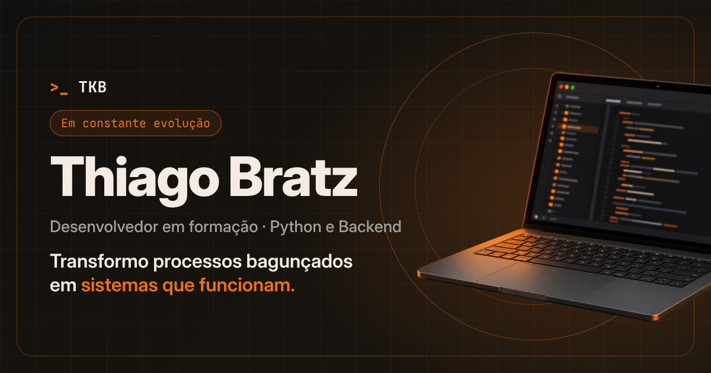

# Portfólio — Thiago Bratz



Portfólio pessoal de Thiago Bratz, desenvolvedor em formação com foco em Python e Backend.

## Sobre o projeto

Site moderno, responsivo e profissional, pensado para recrutadores e empresas. Ele apresenta minha trajetória, as tecnologias que uso e estudo, meus projetos e certificados, e terá um formulário de contato com envio real de e-mail. Cada parte do site é um conhecimento colocado em prática: o projeto inteiro foi construído passo a passo, como parte do meu estudo de desenvolvimento web.

## Status

🚧 Em desenvolvimento.

- [x] Etapa 0: conteúdo
- [x] Etapa 1: planejamento
- [x] Etapa 2: ambiente e Git
- [x] Etapa 3: estrutura HTML e publicação do esqueleto
- [x] Etapa 4: identidade visual (CSS, mobile-first)
- [x] Etapa 5: interações simples (menu, transições, animações, cards a partir de `data/`)
- [x] Etapa 6: carrossel de certificados e páginas de galeria
- [ ] Etapa 7: backend e formulário de contato (FastAPI, e-mail real)
- [ ] Etapa 8: revisão responsiva, acessibilidade e desempenho
- [ ] Etapa 9: finalização e publicação

## O que o site tem hoje

- **Página única com seis seções:** Início, Sobre mim, Tecnologias, Projetos, Certificados e Contato.
- **Transição entre seções em tela cheia** no desktop (a seção atual sobe e a próxima entra de baixo com fade), controlada por JavaScript. Quando a janela é pequena, o JavaScript falha ou o sistema pede movimento reduzido, o site usa a rolagem normal. No celular, a rolagem é sempre a nativa.
- **Carrossel de certificados** com o certificado central em destaque e os vizinhos inteiros nas laterais, controlado por setas, teclado (← →), toque e clique.
- **Páginas de galeria** com todos os projetos (`projetos.html`) e todos os certificados (`certificados.html`).
- **Conteúdo separado do código:** projetos e certificados vivem em arquivos JSON e os cards são montados por JavaScript.
- **Acessibilidade:** link "Pular para o conteúdo", foco visível, `aria-current` no menu, anúncio de posição do carrossel com `aria-live` e respeito a `prefers-reduced-motion`.

## Tecnologias

- HTML5, CSS3 e JavaScript puros (sem frameworks)
- Fontes Inter e JetBrains Mono, hospedadas no próprio projeto
- Python e FastAPI, somente no backend do formulário de contato (Etapa 7)
- Git e GitHub para versionamento

## Estrutura de pastas

```text
portfolio/
├── index.html            # página principal (seções em tela cheia)
├── projetos.html         # galeria com todos os projetos
├── certificados.html     # galeria com todos os certificados
├── assets/               # o que o visitante vê ou baixa
│   ├── css/
│   │   ├── style.css         # estilos gerais
│   │   └── certificados.css  # carrossel e galerias
│   ├── js/
│   │   ├── main.js           # menu, progresso, fade, modo tela cheia, cards de projetos
│   │   ├── projetos.js       # cards de projeto (home e galeria)
│   │   └── certificados.js   # carrossel e galeria de certificados
│   ├── img/
│   ├── icons/
│   ├── fonts/
│   └── docs/             # currículo em PDF
├── data/                 # conteúdo que eu atualizo
│   ├── projetos.json
│   └── certificados.json
├── backend/              # código do servidor (Etapa 7)
├── .gitignore
└── README.md
```

## Como rodar

O site é estático, mas lê os arquivos de `data/` com `fetch`, o que **não funciona abrindo o `index.html` direto no navegador** (`file://`). É preciso um servidor local. Duas opções:

**1. Extensão Live Server do VS Code:** clique com o botão direito no `index.html` e escolha "Open with Live Server".

**2. Python (já instalado na maioria dos sistemas):**

```bash
python3 -m http.server 5500
```

Depois abra `http://127.0.0.1:5500` no navegador.

## Como atualizar o conteúdo

Não é preciso mexer no HTML: basta editar os arquivos em `data/`.

### Novo projeto (`data/projetos.json`)

```json
{
  "nome": "Nome do projeto",
  "categoria": "Sistema web",
  "status": "Em desenvolvimento",
  "descricao": "Uma frase sobre o projeto.",
  "imagem": "assets/img/projetos/arquivo.png",
  "alt": "Descrição da imagem",
  "tecnologias": ["Python", "FastAPI"],
  "privado": false,
  "links": [{ "rotulo": "Repositório", "url": "https://github.com/..." }],
  "destaque": false
}
```

A página principal mostra só os projetos com `"destaque": true`. A página `projetos.html` mostra todos.

### Novo certificado (`data/certificados.json`)

```json
{
  "titulo": "Título do curso",
  "instituicao": "Alura",
  "horas": 8,
  "data": "2026-09-20",
  "imagem": "assets/img/certificados/arquivo.png",
  "alt": "Descrição da imagem",
  "link": "https://link-de-validacao",
  "destaque": true
}
```

O carrossel mostra só os certificados com `"destaque": true`. A página `certificados.html` mostra todos, do mais recente para o mais antigo.

## Variáveis de ambiente

Credenciais (como a senha do e-mail do formulário) **nunca** vão para o GitHub. O backend usará um arquivo `.env`, que está no `.gitignore`, e um `.env.example` sem valores reais para documentar o que é necessário.

## Inspirações

O visual parte dos meus próprios mockups, com referências de transições e tecnologias em [marcomachado.dev.br](https://marcomachado.dev.br) e de certificados e contato em [ryanjeimysson.vercel.app](https://ryanjeimysson.vercel.app).

## Contato

- GitHub: [ThiagoBratz](https://github.com/ThiagoBratz)
- LinkedIn: [Thiago Bratz](https://www.linkedin.com/in/thiago-bratz-31353a413)